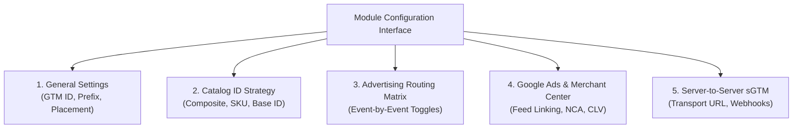
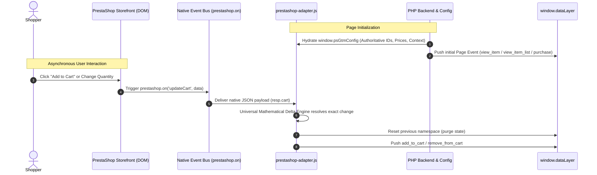
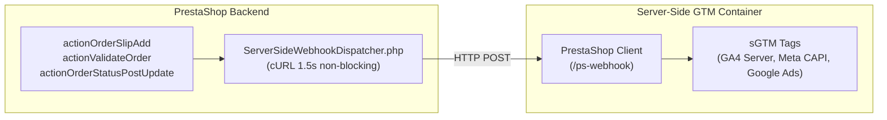
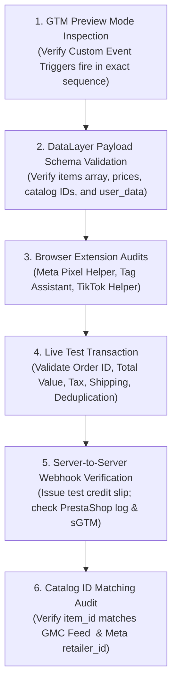

# PrestaShop E-Commerce Tracking Implementation Manual
### Complete Technical Guide: Module Deployment, Data Layer Architecture, GTM Engineering, and Multi-Platform Conversion Tracking

---

## Document Overview
This document serves as the authoritative, production-grade implementation guide for deploying and maintaining full-funnel e-commerce tracking on **PrestaShop (1.7.0.0 – 8.2.x / 9.x)** using the `ps_gtm_datalayer` module, **Google Tag Manager (GTM)**, **Server-Side Google Tag Manager (sGTM)**, and major advertising platforms:
* **Google Analytics 4 (GA4)**
* **Google Ads (Conversions with Cart Data & Retail Dynamic Remarketing)**
* **Meta Pixel & Conversions API (CAPI)**
* **Pinterest Tag & Conversions API (CAPI)**
* **TikTok Pixel & Events API**
* **Microsoft Advertising (Bing Ads & UET)**
* **Server-to-Server sGTM Webhooks (Refunds, Offline Orders & Status Changes)**

---

# Table of Contents
1. [Phase 1: PrestaShop Module Installation](#phase-1-prestashop-module-installation)
2. [Phase 2: Module Settings and Configuration](#phase-2-module-settings-and-configuration)
3. [Phase 3: Data Layer Architecture and Validation](#phase-3-data-layer-architecture-and-validation)
4. [Phase 4: GTM Variable and Trigger Configuration](#phase-4-gtm-variable-and-trigger-configuration)
5. [Phase 5: Platform-Specific Tracking Implementation](#phase-5-platform-specific-tracking-implementation)
6. [Phase 6: E-commerce Event Mapping](#phase-6-e-commerce-event-mapping)
7. [Phase 7: Testing and Quality Assurance](#phase-7-testing-and-quality-assurance)
8. [Phase 8: Troubleshooting Guide](#phase-8-troubleshooting-guide)
9. [Phase 9: Maintenance, Upgrades & Governance](#phase-9-maintenance-upgrades--governance)

---

# Phase 1: PrestaShop Module Installation

### 1.1 System Prerequisites
Ensure the target server meets the following runtime environment specifications:
* **PrestaShop Compatibility**: PrestaShop `1.7.0.0` through `8.2.x` and `9.0.x`.
* **PHP Runtime**: PHP `7.1.0` through `8.3.x` (100% PHP 7/8 backward- and forward-compatible).
* **Required PHP Extensions**:
  * `curl` (used for server-to-server webhook dispatches).
  * `json` (used for payload serialization and deserialization).
  * `mbstring` (used for UTF-8 character handling).
  * `openssl` (used for SHA-256 customer data hashing).
* **Server Memory & Execution Limits**:
  * `memory_limit`: Minimum `256M` (recommended `512M` for large catalogs).
  * `max_execution_time`: Minimum `60s` (recommended `120s`).

---

### 1.2 Installation Methods

#### Method A: PrestaShop Back Office Upload (Standard & Recommended)
1. Download the latest official distribution archive: [`ps_gtm_datalayer.zip`](https://github.com/raihan675/Presta-Shop-Data-Layer/releases/latest).
2. Log into the PrestaShop Back Office as a SuperAdmin.
3. Navigate to **Modules > Module Manager** (PrestaShop 1.7 / 8) or **Modules & Services**.
4. Click the **Upload a module** button in the top right corner.
5. Drag and drop `ps_gtm_datalayer.zip` or browse to select it.
6. Wait for the upload and automated installation routine to complete.
7. Click **Configure** once the success confirmation is displayed.

#### Method B: Manual File System / CLI Installation (For Staging & Large Deployments)
1. Extract `ps_gtm_datalayer.zip` locally. The root folder inside must be `ps_gtm_datalayer`.
2. Connect to your web server via SFTP or SSH.
3. Upload the `ps_gtm_datalayer` directory to the server path:
   ```text
   /var/www/html/modules/ps_gtm_datalayer/
   ```
4. Set standard file system permissions:
   ```bash
   chmod 755 -R /var/www/html/modules/ps_gtm_datalayer/
   find /var/www/html/modules/ps_gtm_datalayer/ -type f -exec chmod 644 {} \;
   chown -R www-data:www-data /var/www/html/modules/ps_gtm_datalayer/
   ```
5. If using CLI, install via PrestaShop console:
   ```bash
   php bin/console prestashop:module install ps_gtm_datalayer
   ```
   Or navigate to **Back Office > Module Manager**, search for **DataLayer**, and click **Install**.

---

### 1.3 Hook Registration Verification Audit
The module depends on 10 core PrestaShop hooks across the storefront lifecycle, admin management, and server-side order processing. During installation, these are automatically registered.

To verify hook registration:
1. Navigate to **Improve > Design > Positions** in the Back Office.
2. Select **Show non-positionable hooks**.
3. Search for `ps_gtm_datalayer` and verify the module is hooked into:

| Hook Name | Hook Type | Functionality |
| :--- | :--- | :--- |
| `displayHeader` | Frontend Template | Injects `window.dataLayer`, `window.psGtmConfig`, and the head GTM snippet. |
| `displayAfterBodyOpeningTag` | Frontend Template | Injects the GTM `<noscript>` iframe snippet immediately after `<body>`. |
| `displayOrderConfirmation` | Frontend Template | Injects the authoritative purchase dataLayer event on order completion. |
| `actionCartUpdateQuantityBefore`| Frontend Action | Captures instant cart quantity delta operations (add/remove) safely. |
| `actionCarrierProcess` | Frontend Action | Captures checkout shipping carrier selection (`add_shipping_info`). |
| `displayBackOfficeTop` | Admin Template | Injects the Back Office 1-Click Update banner when a new release is detected. |
| `displayBackOfficeHeader` | Admin Template | Loads administrative stylesheets and configuration scripts. |
| `actionValidateOrder` | Server Lifecycle | Server-to-server offline order webhook dispatch (`purchase`). |
| `actionOrderSlipAdd` | Server Lifecycle | Server-to-server refund webhook dispatch (`refund`). |
| `actionOrderStatusPostUpdate` | Server Lifecycle | Server-to-server status change webhook dispatch (`order_status_update`). |

> [!TIP]
> If any hook is missing due to a third-party migration or theme reset, navigate to the module configuration page and re-save the settings. The module automatically verifies and re-registers any missing hooks on save.

---

### 1.4 Cache Invalidation Procedure
PrestaShop and reverse-proxy caches must be flushed to activate newly registered hooks and templates:
1. Navigate to **Advanced Parameters > Performance**.
2. Click **Clear cache** in the top right.
3. If using server-level caching (**LiteSpeed / LSCache**, **Varnish**, **Cloudflare**), perform a full cache purge.

---

# Phase 2: Module Settings and Configuration

Navigate to **Modules > Module Manager > E-Commerce DataLayer > Configure**. The configuration interface is divided into functional tabs.



---

### 2.1 General Settings

1. **Google Tag Manager Container ID (`PS_GTM_CONTAINER_ID`)**:
   * Enter your Web GTM Container ID in the standard format: `GTM-XXXXXXX`.
   * When populated, the module automatically generates standard, asynchronous Google Tag Manager scripts in `<head>` and `<body>`.
   * *Leave empty* if you use a custom CMP (Consent Management Platform) that handles GTM script loading or if you use raw code insertion below.

2. **Dynamic Event Prefix (`PS_GTM_EVENT_PREFIX`)**:
   * **Purpose**: Prepends a clean identifier to all client-side event names (e.g. `client_view_item`, `brand_purchase`).
   * **Default**: `empty` (standard canonical GA4 event names: `view_item`, `purchase`, etc.).
   * **Safety Mechanism**: When a prefix is entered, the payload dynamically sets `event: "prefix_purchase"` while strictly preserving the canonical name under `original_event: "purchase"`.

3. **Multi-Store Management**:
   * If running PrestaShop Multi-Store, select the configuration scope from the top bar:
     * **All Shops**: Applies universal defaults.
     * **Specific Shop**: Overrides GTM IDs, prefixes, and catalog strategies on a per-domain basis.

---

### 2.2 Catalog ID Strategy Selection
Matching your product identifiers between your advertising product feeds (Google Merchant Center, Meta Catalog, TikTok Shop) and your tracking tags is the **single most critical requirement for dynamic remarketing and catalog sales attribution**.

Select your strategy under **Catalog ID Strategy (`PS_GTM_CATALOG_ID_STRATEGY`)**:

| Strategy Option | Identifier Format | Example Value | When to Select |
| :--- | :--- | :--- | :--- |
| **Option 1: Composite Product & Attribute ID (Recommended)** | `{id_product}_{id_product_attribute}` | `68_299` (Variant)<br>`1013_0` (Simple) | **Standard for PrestaShop product feeds** where each size/color combination is exported as a unique item. Matches Google Shopping feeds generated with default PrestaShop modules. |
| **Option 2: Reference / SKU Code** | `{reference}` with fallback to `{id_product}` | `TS-BLUE-M`<br>`1013` (Fallback) | Choose if your product feeds use the manufacturer SKU / Reference code as the `<g:id>` / `retailer_id`. Fallback ensures zero empty IDs. |
| **Option 3: Base Product ID** | `{id_product}` | `68`<br>`1013` | Choose if your product catalog aggregates all combinations under the parent base product ID. |

---

### 2.3 Advertising Platform Toggles & Event-Level Routing Matrix
The module allows granular control over which advertising namespaces are generated and dispatched into `window.dataLayer`.

#### Platform Master Toggles:
* **Google Analytics 4**: Enables the standard `ecommerce` object and user-provided customer data.
* **Google Ads**: Enables `google_ads.dynamic_remarketing` and `google_ads.cart_data`.
* **Meta (Facebook/Instagram)**: Enables `meta.*` namespaces (`ViewContent`, `AddToCart`, `Purchase`, etc.).
* **Pinterest Ads**: Enables `pinterest.*` namespaces (`PageVisit`, `AddToCart`, `Checkout`, etc.).
* **TikTok Ads**: Enables `tiktok.*` namespaces (`ViewContent`, `AddToCart`, `CompletePayment`, etc.).
* **Microsoft Advertising (Bing Ads)**: Enables `microsoft_ads.*` namespaces (`view_item`, `add_to_cart`, `purchase`).

#### Event-Level Routing Matrix:
Expand the **Advertising Platform DataLayers & Event Routing** section. You can toggle each platform individually for each of the 11 storefront events.
* *Example*: Enable Google Ads Dynamic Remarketing on `view_item` and `purchase`, while disabling Meta tracking on category listings (`view_item_list`) to save dataLayer payload bandwidth.

---

### 2.4 Google Ads & Merchant Center Settings
Configure these parameters to unlock **Google Ads Conversions with Cart Data** and **Retail Dynamic Remarketing**:

1. **Google Merchant Center Account ID (`PS_GTM_GMC_MERCHANT_ID`)**:
   * Enter your 8- to 10-digit Merchant Center ID (e.g. `123456789`).
   * Injected as `aw_merchant_id` during purchase conversions, enabling gross profit reporting and product-level conversion reporting in Google Ads.
2. **Feed Country (`PS_GTM_GMC_FEED_COUNTRY`)**:
   * 2-letter CLDR country code matching your GMC primary feed (e.g. `US`, `DE`, `FR`, `GB`).
3. **Feed Language (`PS_GTM_GMC_FEED_LANGUAGE`)**:
   * 2-letter ISO language code matching your GMC feed language (e.g. `en`, `de`, `fr`).
4. **Google Ads Dynamic Remarketing Vertical**:
   * Set to `retail` (default). Emits `google_business_vertical: 'retail'` across all dynamic remarketing items arrays.
5. **New Customer Acquisition (NCA) & Customer Lifetime Value (CLV)**:
   * Enabled automatically. Computes customer order history directly from PrestaShop core tables (`ps_orders`) to hydrate `new_customer: true/false` and numeric `customer_lifetime_value`.

---

### 2.5 Server-Side GTM & Webhook Settings
1. **Server-Side GTM Transport URL (`PS_SGTM_TRANSPORT_URL`)**:
   * Enter your sGTM custom subdomain or Stape.io endpoint:
     ```text
     https://sgtm.yourdomain.com
     ```
2. **Webhook Endpoint Path (`PS_SGTM_WEBHOOK_ENDPOINT_PATH`)**:
   * Default: `/ps-webhook`. The complete destination becomes `https://sgtm.yourdomain.com/ps-webhook`.
3. **Server-to-Server Refund Webhooks (`PS_GTM_WEBHOOK_REFUND_ENABLED`)**:
   * **Enabled**: Sends server-to-server `refund` events to sGTM upon Credit Slip generation in the Back Office.
4. **Server-to-Server Offline Order Webhooks (`PS_GTM_WEBHOOK_OFFLINE_ORDER_ENABLED`)**:
   * **Enabled**: Sends `purchase` conversions to sGTM for orders created manually by administrators in the Back Office or via phone orders.
5. **Server-to-Server Order Status Change Webhooks (`PS_GTM_WEBHOOK_STATUS_UPDATE_ENABLED`)**:
   * **Enabled**: Dispatches asynchronous `order_status_update` events whenever an order status changes (e.g., Bank Wire / COD moving to *Payment accepted*, or orders moving to *Canceled*).

---

# Phase 3: Data Layer Architecture and Validation

### 3.1 Zero DOM Scraping Architecture
Unlike fragile tracking plugins that scrape product names, variant IDs, or prices from CSS selectors, `ps_gtm_datalayer` operates with a **strict backend-driven architecture**:



#### Why Backend-Hydrated Data Guarantees 100% Tracking Fidelity:
1. **Zero CSS Breakage**: Updating your theme, redesigning buttons, or modifying template HTML will never break event tracking.
2. **Clean Multi-Currency Pricing**: Prices are extracted from PrestaShop mathematical float values, never parsed from formatted currency strings (e.g., preventing `$ 1.250,50` being misread as `$ 1.25`).
3. **Authoritative Variant Attributes**: Line items carry the exact combination attribute IDs (`id_product_attribute`) and formatted attributes (`Size: XL, Color: Navy`) resolved from the database.

---

### 3.2 Dual-Payload Architecture
Every storefront event pushes a standardized, multi-namespace payload into `window.dataLayer`. This allows a tracking specialist to configure GA4 and advertising platforms in GTM with **zero custom JavaScript conversion code**:

```javascript
window.dataLayer.push({
  // 1. Event Identification
  "event": "view_item",
  "original_event": "view_item",

  // 2. Canonical GA4 E-Commerce Specification
  "ecommerce": {
    "currency": "EUR",
    "value": 26.00,
    "items": [
      {
        "item_id": "68_299",
        "item_name": "Trink und Snack Tasse",
        "item_brand": "Dooky",
        "item_category": "Trinkbecher",
        "item_variant": "Farbe: Stahlblau",
        "price": 13.00,
        "quantity": 2
      }
    ]
  },

  // 3. Native Meta Pixel & Conversions API Namespace
  "meta": {
    "event_name": "ViewContent",
    "content_type": "product",
    "content_ids": ["68_299"],
    "contents": [
      { "id": "68_299", "quantity": 2, "item_price": 13.00 }
    ],
    "currency": "EUR",
    "value": 26.00
  },

  // 4. Native Google Ads Remarketing & Cart Data Namespace
  "google_ads": {
    "dynamic_remarketing": {
      "event_name": "view_item",
      "ecomm_pagetype": "product",
      "ecomm_prodid": ["68_299"],
      "ecomm_totalvalue": 26.00,
      "items": [
        { "id": "68_299", "google_business_vertical": "retail" }
      ]
    }
  },

  // 5. Native Pinterest Ads Namespace
  "pinterest": {
    "event_name": "PageVisit",
    "product_ids": ["68_299"],
    "line_items": [
      {
        "product_id": "68_299",
        "product_name": "Trink und Snack Tasse",
        "product_price": 13.00,
        "product_quantity": 2
      }
    ],
    "currency": "EUR",
    "value": 26.00
  },

  // 6. Native TikTok Pixel & Events API Namespace
  "tiktok": {
    "event_name": "ViewContent",
    "content_type": "product",
    "content_ids": ["68_299"],
    "contents": [
      {
        "content_id": "68_299",
        "content_type": "product",
        "quantity": 2,
        "price": 13.00
      }
    ],
    "currency": "EUR",
    "value": 26.00
  },

  // 7. Native Microsoft Advertising (Bing UET) Namespace
  "microsoft_ads": {
    "event_action": "view_item",
    "revenue_value": 26.00,
    "currency": "EUR",
    "dynamic_remarketing": {
      "ecomm_pagetype": "product",
      "ecomm_prodid": ["68_299"],
      "ecomm_totalvalue": 26.00
    }
  }
});
```

---

### 3.3 State Reset & Deduplication Protocols
To prevent "sticky" parameters across Single Page Application (SPA) actions and consecutive AJAX operations:
1. **Namespace Purging**: Before every event push, the module executes:
   ```javascript
   window.dataLayer.push({
     ecommerce: null,
     meta: null,
     google_ads: null,
     pinterest: null,
     tiktok: null,
     microsoft_ads: null
   });
   ```
2. **Transaction Deduplication**: Storefront `purchase` events store the transaction ID in `gtm_purchase_log` and local session storage. Refreshing the Thank-You / Order Confirmation page will never emit a duplicate `purchase` event.

---

### 3.4 Validating DataLayer via DevTools Console
To inspect real-time dataLayer activity on your storefront:
1. Open Google Chrome DevTools (`F12` or `Ctrl+Shift+I` / `Cmd+Option+I`).
2. Switch to the **Console** tab.
3. Paste the following diagnostic snippet:
   ```javascript
   console.table(
     window.dataLayer
       .filter(e => e.event && !e.event.startsWith('gtm.'))
       .map(e => ({
         Event: e.event,
         Original: e.original_event || e.event,
         Value: e.ecommerce ? e.ecommerce.value : (e.meta ? e.meta.value : 'N/A'),
         Currency: e.ecommerce ? e.ecommerce.currency : 'N/A',
         Items_Count: e.ecommerce && e.ecommerce.items ? e.ecommerce.items.length : 0
       }))
   );
   ```
4. Output will display a clean summary table of all captured e-commerce events with values and item counts.

---

# Phase 4: GTM Variable and Trigger Configuration

In Google Tag Manager, configure the following variables and triggers to extract data directly from the dataLayer.

### 4.1 Data Layer Variable (DLV) Master Dictionary

Create the following **Data Layer Variables** in GTM under **Variables > User-Defined Variables > New > Data Layer Variable**:

#### GA4 & Universal E-Commerce Variables:
| Variable Name in GTM | Data Layer Variable Name | Description |
| :--- | :--- | :--- |
| `{{dlv - ecommerce.currency}}` | `ecommerce.currency` | 3-letter ISO Currency code (`EUR`, `USD`, etc.) |
| `{{dlv - ecommerce.value}}` | `ecommerce.value` | Float monetary value of the event |
| `{{dlv - ecommerce.items}}` | `ecommerce.items` | Canonical array of product items |
| `{{dlv - ecommerce.transaction_id}}` | `ecommerce.transaction_id` | PrestaShop numeric Order ID |
| `{{dlv - ecommerce.coupon}}` | `ecommerce.coupon` | Applied voucher / coupon code |
| `{{dlv - ecommerce.shipping}}` | `ecommerce.shipping` | Shipping cost |
| `{{dlv - ecommerce.tax}}` | `ecommerce.tax` | Total tax amount |
| `{{dlv - ecommerce.search_term}}` | `ecommerce.search_term` | On-site search query keyword |
| `{{dlv - ecommerce.item_list_id}}` | `ecommerce.item_list_id` | Category or list identifier (`category_12`) |
| `{{dlv - ecommerce.item_list_name}}` | `ecommerce.item_list_name` | Name of the product list (`Trinkbecher`) |

#### Meta (Facebook & Instagram) Variables:
| Variable Name in GTM | Data Layer Variable Name | Description |
| :--- | :--- | :--- |
| `{{dlv - meta.event_name}}` | `meta.event_name` | Meta standard event (`ViewContent`, `AddToCart`, etc.) |
| `{{dlv - meta.content_ids}}` | `meta.content_ids` | Array of catalog product IDs |
| `{{dlv - meta.content_type}}` | `meta.content_type` | `product` or `product_group` |
| `{{dlv - meta.contents}}` | `meta.contents` | Official Meta line items array (`id`, `quantity`, `item_price`) |
| `{{dlv - meta.value}}` | `meta.value` | Monetary event value |
| `{{dlv - meta.currency}}` | `meta.currency` | Currency code |
| `{{dlv - meta.num_items}}` | `meta.num_items` | Total item count across cart/checkout |
| `{{dlv - meta.order_id}}` | `meta.order_id` | Order reference for CAPI deduplication |
| `{{dlv - meta.user_data}}` | `meta.user_data` | SHA-256 hashed customer Advanced Matching object |

#### Google Ads Variables:
| Variable Name in GTM | Data Layer Variable Name | Description |
| :--- | :--- | :--- |
| `{{dlv - google_ads.dynamic_remarketing.items}}` | `google_ads.dynamic_remarketing.items` | Dedicated remarketing array (`id`, `google_business_vertical`) |
| `{{dlv - google_ads.dynamic_remarketing.ecomm_prodid}}` | `google_ads.dynamic_remarketing.ecomm_prodid` | GMC Feed product IDs |
| `{{dlv - google_ads.dynamic_remarketing.ecomm_pagetype}}` | `google_ads.dynamic_remarketing.ecomm_pagetype` | Standard funnel value (`category`, `product`, `cart`, `purchase`) |
| `{{dlv - google_ads.dynamic_remarketing.ecomm_totalvalue}}` | `google_ads.dynamic_remarketing.ecomm_totalvalue` | Remarketing page value |
| `{{dlv - google_ads.cart_data.items}}` | `google_ads.cart_data.items` | Cart data items array (`id`, `price`, `quantity`) |
| `{{dlv - google_ads.cart_data.new_customer}}` | `google_ads.cart_data.new_customer` | Boolean (`true`/`false`) for New Customer Acquisition |
| `{{dlv - google_ads.cart_data.customer_lifetime_value}}`| `google_ads.cart_data.customer_lifetime_value` | Numeric customer lifetime value |

#### Pinterest, TikTok & Microsoft Ads Variables:
| Variable Name in GTM | Data Layer Variable Name | Description |
| :--- | :--- | :--- |
| `{{dlv - pinterest.line_items}}` | `pinterest.line_items` | Official Pinterest items array |
| `{{dlv - pinterest.product_ids}}` | `pinterest.product_ids` | Array of product IDs for Pinterest |
| `{{dlv - pinterest.user_data}}` | `pinterest.user_data` | Pinterest Enhanced Matching object |
| `{{dlv - tiktok.contents}}` | `tiktok.contents` | Official TikTok items array |
| `{{dlv - tiktok.content_ids}}` | `tiktok.content_ids` | Array of product IDs for TikTok |
| `{{dlv - tiktok.user_data}}` | `tiktok.user_data` | TikTok Advanced Matching object |
| `{{dlv - microsoft_ads.dynamic_remarketing.ecomm_prodid}}` | `microsoft_ads.dynamic_remarketing.ecomm_prodid` | Array of product IDs for Microsoft UET |
| `{{dlv - microsoft_ads.revenue_value}}` | `microsoft_ads.revenue_value` | Normalized Microsoft conversion value |
| `{{dlv - microsoft_ads.pid}}` | `microsoft_ads.pid` | Microsoft Enhanced Conversions customer hashes |

---

### 4.2 GTM Custom Event Triggers

Create the following **Custom Event Triggers** under **Triggers > New > Custom Event**:

| Trigger Name in GTM | Event Name Setting | Use Regex? | Trigger Firing Condition |
| :--- | :--- | :--- | :--- |
| `ce - view_item_list` | `view_item_list` | No | Category, brand, or feature product listings |
| `ce - view_search_results` | `view_search_results` | No | Search results page view |
| `ce - view_item` | `view_item` | No | Product detail page view or combination switch |
| `ce - select_item` | `select_item` | No | Product card click from listings |
| `ce - add_to_cart` | `add_to_cart` | No | Cart additions and quantity increments |
| `ce - remove_from_cart` | `remove_from_cart` | No | Cart deletions and quantity decrements |
| `ce - view_cart` | `view_cart` | No | Shopping cart summary view |
| `ce - begin_checkout` | `begin_checkout` | No | Checkout step 1 entry |
| `ce - add_shipping_info` | `add_shipping_info` | No | Carrier selection confirmed |
| `ce - add_payment_info` | `add_payment_info` | No | Payment method selected |
| `ce - purchase` | `purchase` | No | Order confirmation completed |

#### Prefix-Agnostic Regex Trigger (Recommended when using Event Prefixes):
If your store uses a dynamic event prefix (e.g. `ps_purchase`), configure a single universal trigger or individual regex triggers:
* **Event name**: `.*(view_item|add_to_cart|begin_checkout|purchase)`
* **Check**: Use regex matching.

---

# Phase 5: Platform-Specific Tracking Implementation

---

### 5.1 Google Analytics 4 (GA4) Implementation

#### Step 1: Google Tag (Configuration)
1. In GTM, create a new Tag: **Google Analytics > Google Tag**.
2. **Tag ID**: Enter your GA4 Measurement ID (`G-XXXXXXXXXX`).
3. **Trigger**: `Initialization - All Pages` or `Consent Initialization - All Pages`.
4. Under **Configuration Settings**, add:
   * Parameter: `send_page_view`, Value: `true`.

#### Step 2: GA4 Event Tag (All E-Commerce Events)
1. Create a new Tag: **Google Analytics > Google Analytics: GA4 Event**.
2. **Measurement ID**: Reference your GA4 Measurement ID or Google Tag.
3. **Event Name**: `{{Event}}` (or `{{dlv - original_event}}` if using prefixes).
4. **Event Parameters**:
   * Add Parameter: `ecommerce`, Value: `{{dlv - ecommerce}}`.
5. Under **More Settings > User-Provided Data**:
   * Select a User-Provided Data Variable mapped to `{{dlv - user_data}}` (providing SHA-256 hashed email, phone, and address for GA4 Enhanced Measurement).
6. **Triggering**: Select all 11 custom e-commerce triggers (`ce - view_item_list`, `ce - view_item`, `ce - add_to_cart`, `ce - purchase`, etc.).

---

### 5.2 Google Ads Implementation

#### Step 1: Google Ads Conversion Tracking (Purchase)
1. Create a new Tag: **Google Ads > Google Ads Conversion Tracking**.
2. **Conversion ID**: Enter your numeric Conversion ID (e.g. `123456789`).
3. **Conversion Label**: Enter the specific Purchase Conversion Label from Google Ads.
4. **Conversion Value**: `{{dlv - ecommerce.value}}`.
5. **Currency Code**: `{{dlv - ecommerce.currency}}`.
6. **Transaction ID**: `{{dlv - ecommerce.transaction_id}}`.
7. **Enhanced Conversions**:
   * Enable **Include user-provided data from your website**.
   * Map to a User-Provided Data variable referencing `{{dlv - user_data}}`.
8. **Conversions with Cart Data**:
   * Check **Provide cart data**.
   * Line Items: `{{dlv - google_ads.cart_data.items}}`.
   * Merchant Center ID: `{{dlv - google_ads.cart_data.aw_merchant_id}}`.
   * Feed Country: `{{dlv - google_ads.cart_data.aw_feed_country}}`.
   * Feed Language: `{{dlv - google_ads.cart_data.aw_feed_language}}`.
   * Discount: `{{dlv - google_ads.cart_data.discount}}`.
9. **New Customer Acquisition (NCA)**:
   * Provide new customer parameter: `{{dlv - google_ads.cart_data.new_customer}}`.
   * Customer Lifetime Value: `{{dlv - google_ads.cart_data.customer_lifetime_value}}`.
10. **Trigger**: `ce - purchase`.

#### Step 2: Google Ads Dynamic Remarketing (Retail Vertical)
1. Create a new Tag: **Google Ads > Google Ads Remarketing**.
2. **Conversion ID**: Enter your Google Ads Conversion ID.
3. Check **Send dynamic remarketing event data**.
4. **Event Name**: `{{Event}}`.
5. **Event Value**: `{{dlv - google_ads.dynamic_remarketing.ecomm_totalvalue}}`.
6. **Event Items**: `{{dlv - google_ads.dynamic_remarketing.items}}`.
7. Under **Custom Parameters**, add:
   * Parameter: `ecomm_pagetype`, Value: `{{dlv - google_ads.dynamic_remarketing.ecomm_pagetype}}`.
   * Parameter: `ecomm_prodid`, Value: `{{dlv - google_ads.dynamic_remarketing.ecomm_prodid}}`.
   * Parameter: `ecomm_totalvalue`, Value: `{{dlv - google_ads.dynamic_remarketing.ecomm_totalvalue}}`.
8. **Trigger**: Select `ce - view_item_list`, `ce - view_search_results`, `ce - view_item`, `ce - view_cart`, and `ce - purchase`.

---

### 5.3 Meta (Facebook / Instagram) Pixel & CAPI Implementation

#### Step 1: Meta Base Code
Deploy your standard Meta Base Code (`fbq('init', 'PIXEL_ID');`) on `All Pages` or via the official **Facebook Pixel** Community Template.

#### Step 2: Meta E-Commerce Events Tag
1. Create a Tag using the **Facebook Pixel** template or a Custom HTML Tag.
2. Configure dynamic event parameters using the native `meta.*` variables:
   ```html
   <script>
     fbq('track', '{{dlv - meta.event_name}}', {
       content_type: '{{dlv - meta.content_type}}',
       content_ids: {{dlv - meta.content_ids}},
       contents: {{dlv - meta.contents}},
       value: {{dlv - meta.value}},
       currency: '{{dlv - meta.currency}}',
       num_items: {{dlv - meta.num_items}} || undefined,
       order_id: '{{dlv - meta.order_id}}' || undefined
     }, {
       eventID: '{{dlv - meta.order_id}}' || undefined
     });
   </script>
   ```
3. **Advanced Matching**: Pass `{{dlv - meta.user_data}}` directly during `fbq('init')` or on purchase for full 8-parameter user matching (`em`, `ph`, `fn`, `ln`, `ct`, `st`, `zp`, `country`).
4. **Triggering**: All custom e-commerce triggers.

---

### 5.4 Pinterest Ads Implementation

1. Create a Tag using the official **Pinterest Tag** Community Template.
2. **Tag ID**: Enter your Pinterest Tag ID.
3. **Event**: Select dynamically or map per trigger:
   * `PageVisit` ➔ Triggered on `ce - view_item`.
   * `ViewCategory` ➔ Triggered on `ce - view_item_list`.
   * `AddToCart` ➔ Triggered on `ce - add_to_cart`.
   * `InitiateCheckout` ➔ Triggered on `ce - begin_checkout`.
   * `Checkout` ➔ Triggered on `ce - purchase`.
4. **Parameters Mapping**:
   * Order Value: `{{dlv - ecommerce.value}}`
   * Currency: `{{dlv - ecommerce.currency}}`
   * Order ID: `{{dlv - pinterest.order_id}}`
   * Line Items: `{{dlv - pinterest.line_items}}`
   * Enhanced Matching Data: `{{dlv - pinterest.user_data}}`

---

### 5.5 TikTok Ads Implementation

1. Create a Tag using the official **TikTok Pixel** Community Template.
2. **Pixel ID**: Enter your TikTok Pixel ID.
3. **Standard Events**:
   * Map `ViewContent` ➔ `ce - view_item`.
   * Map `AddToCart` ➔ `ce - add_to_cart`.
   * Map `InitiateCheckout` ➔ `ce - begin_checkout`.
   * Map `CompletePayment` ➔ `ce - purchase`.
4. **Parameters Mapping**:
   * Contents: `{{dlv - tiktok.contents}}`
   * Content Type: `{{dlv - tiktok.content_type}}`
   * Value: `{{dlv - ecommerce.value}}`
   * Currency: `{{dlv - ecommerce.currency}}`
5. **Advanced Matching**: Map `email` to `{{dlv - tiktok.user_data.email}}` and `phone_number` to `{{dlv - tiktok.user_data.phone_number}}`.

---

### 5.6 Microsoft Advertising (Bing Ads / UET) Implementation

1. Create a Tag: **Microsoft Advertising > Microsoft Advertising Universal Event Tracking (UET)**.
2. **UET Tag ID**: Enter your numeric Tag ID.
3. **Track Dynamic Remarketing**: Enable.
   * Pagetype: `{{dlv - microsoft_ads.dynamic_remarketing.ecomm_pagetype}}`.
   * Product IDs: `{{dlv - microsoft_ads.dynamic_remarketing.ecomm_prodid}}`.
   * Total Value: `{{dlv - microsoft_ads.revenue_value}}`.
4. **Track Variable Revenue**:
   * Goal Value: `{{dlv - microsoft_ads.revenue_value}}`.
   * Currency: `{{dlv - ecommerce.currency}}`.
   * Transaction ID: `{{dlv - ecommerce.transaction_id}}`.
5. **Enhanced Conversions**: Bind `pid` to `{{dlv - microsoft_ads.pid}}`.

---

### 5.7 Server-Side GTM (sGTM) & Webhook Integration



1. In your **Server-Side GTM Container**, navigate to **Templates > Clients > New** and import [`prestashop-client-template.tpl`](file:///C:/Users/Webanalyticspro%20BD/.gemini/antigravity/scratch/ps_gtm_datalayer/templates/prestashop-client-template.tpl).
2. Create a Client using this template:
   * Path: `/ps-webhook`.
3. The client receives server-to-server POST requests and automatically parses:
   * **`refund`**: Fired on Credit Slip generation with exact refunded items and values. Routes to GA4 Server Tag as `refund`.
   * **`purchase`**: Fired on Back Office offline orders. Routes to GA4 Server Tag and Meta CAPI.
   * **`order_status_update`**: Fired when payment clears (e.g. Bank Wire). Routes to Google Ads Conversion Adjustments or Meta Offline Events.

---

# Phase 6: E-commerce Event Mapping

### Master Event & Namespace Matrix

| # | Storefront Action | GA4 Event Name | Meta Event | Google Ads Remarketing | Pinterest Event | TikTok Event | Microsoft UET Action |
| :-: | :--- | :--- | :--- | :--- | :--- | :--- | :--- |
| **1** | Category / Listing View | `view_item_list` | `ViewCategory` | `category` | `ViewCategory` | `ViewContent` | `view_item_list` |
| **2** | Search Results View | `view_search_results` | `Search` | `searchresults`| `Search` | `Search` | `view_search_results` |
| **3** | Product Detail View | `view_item` | `ViewContent` | `product` | `PageVisit` | `ViewContent` | `view_item` |
| **4** | Product Card Click | `select_item` | *(Custom)* | `category` | *(Custom)* | *(Custom)* | `select_item` |
| **5** | Add to Wishlist | `add_to_wishlist` | `AddToWishlist`| `other` | `AddToWishList` | `AddToWishlist`| `add_to_wishlist` |
| **6** | Add to Cart / Increment | `add_to_cart` | `AddToCart` | `cart` | `AddToCart` | `AddToCart` | `add_to_cart` |
| **7** | Remove / Decrement Cart | `remove_from_cart` | *(Custom)* | `cart` | *(Custom)* | *(Custom)* | `remove_from_cart` |
| **8** | View Cart Summary | `view_cart` | *(Custom)* | `cart` | *(Custom)* | *(Custom)* | `view_cart` |
| **9** | Enter Checkout (Step 1) | `begin_checkout` | `InitiateCheckout`| `cart` | `InitiateCheckout`| `InitiateCheckout`| `begin_checkout` |
| **10**| Confirm Carrier (Step 3)| `add_shipping_info`| *(Custom)* | `cart` | *(Custom)* | `AddShippingInfo` | `add_shipping_info` |
| **11**| Select Payment (Step 4)| `add_payment_info` | `AddPaymentInfo`| `cart` | `AddPaymentInfo` | `AddPaymentInfo` | `add_payment_info` |
| **12**| Order Completed | `purchase` | `Purchase` | `purchase` | `Checkout` | `CompletePayment`| `purchase` |
| **13**| Credit Slip Issued | `refund` *(Server)* | `Refund` *(CAPI)*| Retract/Adjustment | *(Custom)* | *(CAPI)* | N/A |
| **14**| Payment Status Changed | `order_status_update`*(Server)*| Offline Event | Offline Adjustment | *(Custom)* | *(CAPI)* | N/A |

---

# Phase 7: Testing and Quality Assurance

Execute this quality assurance checklist before publishing GTM changes to production:



### 7.1 Browser Extension Verification
1. **Google Tag Assistant**:
   * Connect to your storefront via Tag Assistant (`tagassistant.google.com`).
   * Confirm Google Tag connects (`HTTP 200`).
   * Verify all 11 e-commerce events record in the left-hand timeline without yellow/red warnings.
2. **Meta Pixel Helper**:
   * Navigate through PDP ➔ Cart ➔ Checkout.
   * Verify green checkmarks on `ViewContent`, `AddToCart`, and `Purchase`.
   * Confirm `content_ids` matches your Meta Commerce Manager catalog items.
3. **TikTok Pixel Helper & Pinterest Tag Helper**:
   * Confirm `ViewContent`, `AddToCart`, and `CompletePayment` report active status with matching product identifiers.

---

### 7.2 End-to-End E-Commerce Transaction Test
1. Set up a test payment method (e.g., **Cash on Delivery** or a test credit card gateway).
2. Add a variable product (combination) to cart:
   * Verify `view_item` fired with combination ID (e.g. `68_299`).
   * Verify `add_to_cart` fired with quantity and correct unit price.
3. Complete the checkout funnel:
   * Verify `begin_checkout`, `add_shipping_info`, and `add_payment_info`.
4. Land on the **Order Confirmation** page:
   * Confirm `purchase` fires with authoritative numeric `transaction_id`.
   * Verify `user_data` contains hashed customer details.
5. **Deduplication Check**:
   * Refresh the Thank-You page (`F5`).
   * Confirm `purchase` **does not fire a second time**.

---

### 7.3 Catalog ID Reconciliation Audit
Ensure your tracking tags pass the exact same ID as your advertising feed:
1. Open your Google Merchant Center product feed export.
2. Locate a product combination (e.g., Product `15`, Combination `82`).
3. Note the `<g:id>` value (e.g. `15_82` or `SKU-15-82`).
4. Inspect the `view_item` event in GTM Preview.
5. Ensure `ecommerce.items[0].item_id` and `google_ads.dynamic_remarketing.ecomm_prodid[0]` match the `<g:id>` string character-for-character.

---

# Phase 8: Troubleshooting Guide

| Issue / Symptom | Root Cause | Diagnostic Step | Permanent Resolution |
| :--- | :--- | :--- | :--- |
| **GTM Container not loading on storefront** | Missing GTM Container ID or template cache not cleared. | View storefront HTML source (`Ctrl+U`) and search for `GTM-`. | 1. Enter GTM ID in module settings and click **Save Settings**.<br>2. Clear PrestaShop cache via **Advanced Parameters > Performance**. |
| **Duplicate purchase events on Thank-You page** | Theme re-renders confirmation hook or cache layer caches order confirmation page. | Check GTM Preview timeline on page reload. | The module includes built-in deduplication via `gtm_purchase_log`. Ensure PrestaShop core database table `ps_gtm_purchase_log` exists. |
| **Combination variant attributes missing on PDP** | Third-party theme uses non-standard AJAX attribute selector instead of PrestaShop core event bus. | In console, run `prestashop.on('updatedProduct', function(e){ console.log(e); })` and switch variants. | The module automatically binds to `prestashop.on('updatedProduct')`. Ensure your custom theme emits standard PrestaShop JavaScript events. |
| **Catalog IDs do not match Google Merchant Center** | Mismatch between module Catalog ID Strategy and feed export plugin. | Compare `item_id` in dataLayer with `<g:id>` in Google Merchant Center. | Switch **Catalog ID Strategy** in module configuration to match your feed export (`composite` vs `reference_sku`). |
| **Consent Mode (CoMo v2) blocking all tags** | GTM tags require consent that has not been granted by user. | Check GTM Preview **Consent** tab on the event. | Configure your Cookie Banner / CMP to update Google Consent Mode (`ad_storage`, `analytics_storage`, `ad_user_data`, `ad_personalization`) upon acceptance. |
| **Server-to-Server Webhook returns HTTP 0 or timeout** | Server firewall blocking outbound cURL or sGTM URL invalid. | Check PrestaShop Back Office **Advanced Parameters > Logs**. | 1. Ensure `PS_SGTM_TRANSPORT_URL` starts with `https://`.<br>2. Whitelist outbound port `443` on hosting firewall. |

---

# Phase 9: Maintenance, Upgrades & Governance

### 9.1 Module Update Workflow
The module incorporates an automated **1-Click Update System**:
1. When a new release is published, a notification banner appears in the PrestaShop Back Office.
2. Click **Update Module** to trigger the automated in-place upgrade.
3. The update manager downloads the verified archive, validates the SHA-256 checksum, replaces files, executes the appropriate `upgrade-X.Y.Z.php` script, and flushes Smarty template caches automatically.

### 9.2 Tag Governance & Ongoing Audit
* **Monthly Audit**: Inspect Google Merchant Center Diagnostics for "Missing microdata / Dynamic Remarketing ID mismatches".
* **Quarterly Audit**: Inspect Meta Event Manager for Event Quality Match Scores (EMQ) on `Purchase` and `AddToCart` (should exceed `8.0/10` with Advanced Matching active).
* **PrestaShop Upgrades**: When upgrading PrestaShop core (e.g. `1.7.8` to `8.2.x`), re-verify hook positions under **Improve > Design > Positions**.
